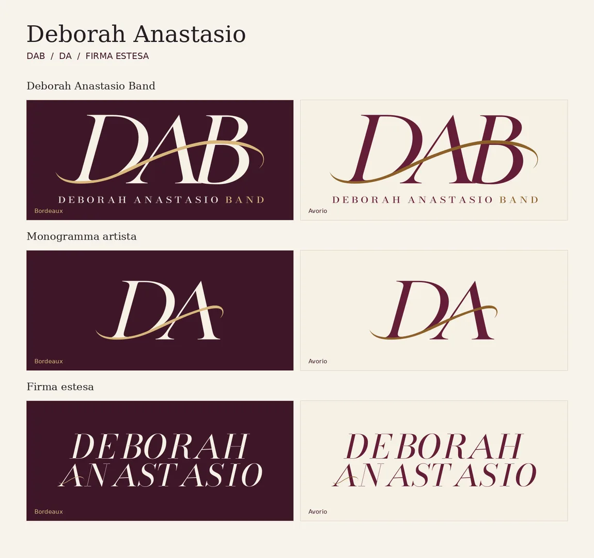
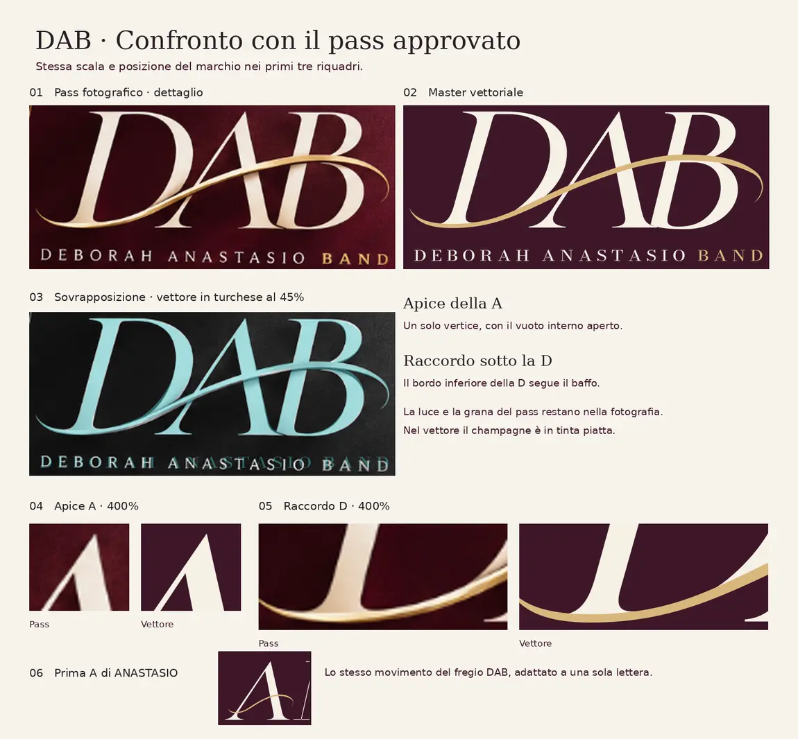
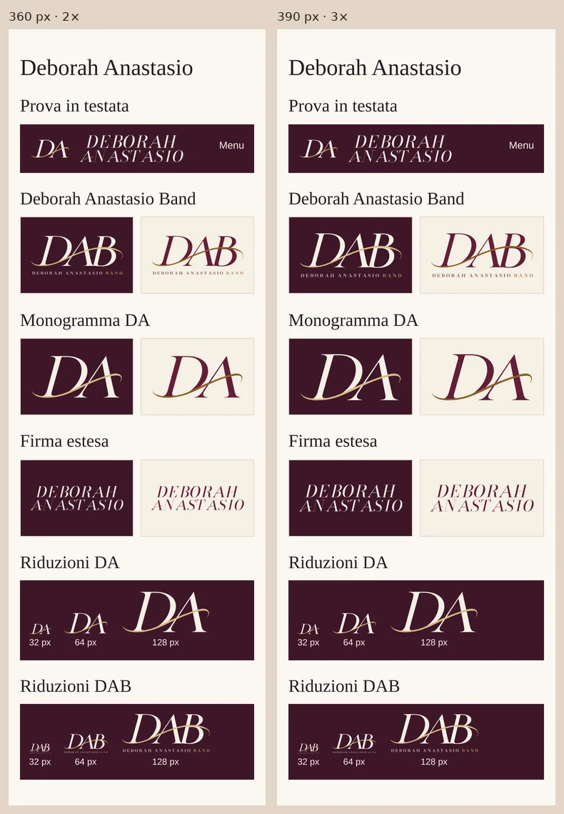

# Deborah Anastasio · Revisione dei marchi

Proposta per approvazione estetica. I file di questa cartella sono separati dagli asset utilizzati dal sito.

## Vettoriali

| Marchio | Per fondo bordeaux | Per fondo avorio | Monocromia |
| --- | --- | --- | --- |
| Deborah Anastasio Band | [DAB](DAB.svg) | [DAB](DAB-avorio.svg) | [Bordeaux](DAB-mono-bordeaux.svg), [avorio](DAB-mono-avorio.svg) |
| Monogramma Deborah Anastasio | [DA](DA.svg) | [DA](DA-avorio.svg) | [Bordeaux](DA-mono-bordeaux.svg), [avorio](DA-mono-avorio.svg) |
| Firma estesa | [Deborah Anastasio](Deborah-Anastasio.svg) | [Deborah Anastasio](Deborah-Anastasio-avorio.svg) | [Bordeaux](Deborah-Anastasio-mono-bordeaux.svg), [avorio](Deborah-Anastasio-mono-avorio.svg) |

Tutti gli SVG hanno sfondo trasparente, tracciati modificabili e colori incorporati. La base delle lettere della firma e della denominazione DAB è Bodoni Moda, licenza SIL OFL 1.1. I file contengono i soli contorni delle lettere utilizzate.

## Confronto con il pass

- Ricostruzione di D, A, B e fregio su coordinate del pass approvato da 393 × 289 px. Il fregio parte prima della D, ne segue il bordo inferiore e mantiene il ritorno sottile a destra. La A ha un unico apice e la sagoma interna si apre sotto il vertice.
- La denominazione ai piedi della sigla è riallineata su una base orizzontale. Il champagne in tinta piatta uniforma i riflessi del pass, conservando la gerarchia avorio/oro con BAND in champagne. Le terminazioni sottili, la spaziatura del nome e le curvature sono stime ottiche guidate dalla risoluzione del pass.
- Il DA condivide esattamente i tracciati di D e A. Il fregio conserva il tratto iniziale del master e si richiude dopo la A.
- Nella firma, le A partono dalla A del master. Sulla prima A di ANASTASIO il fregio riprende lo stesso tracciato, adattato in larghezza, altezza e posizione per attraversare la lettera come traversa.

## Resa in piccolo

[Anteprima HTML](index.html) da aprire in locale dopo aver scaricato la cartella. Verificata in Chromium a 360 px (2×), 390 px (3×) e 1440 px. Tutti gli SVG si caricano e non si genera scorrimento orizzontale. A 32 px si riconoscono le sigle, mentre si perdono alcuni tratti sottili. A 64 px il DA è adatto all’avatar. La denominazione del DAB richiede una visualizzazione più ampia di quella di un avatar. L’anteprima rappresenta una testata di prova.
